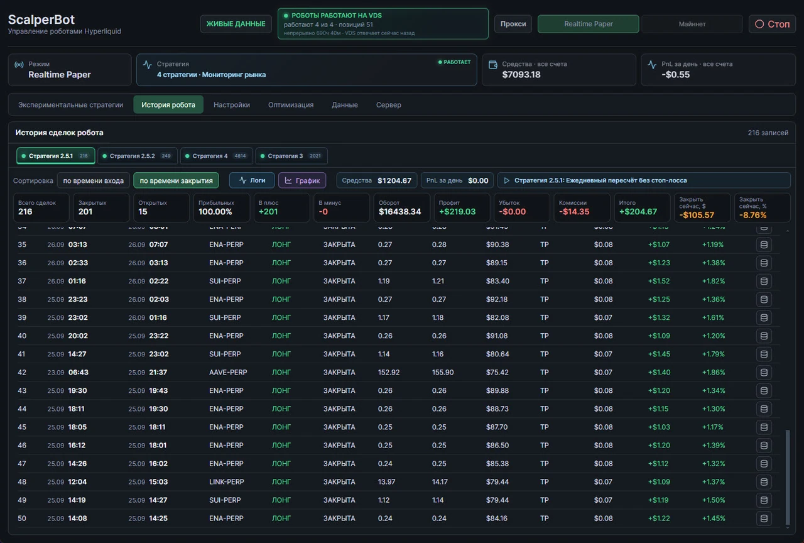

# ScalperBot - терминал анализа рынка

**Автор проекта:** [Евгений Толмачев](https://github.com/EvgenyET) · [Страница проекта в портфолио](https://evgeny-dev.pro/project.html?id=ScalperBot)

Терминал Hyperliquid со стаканом и лентой сделок. Анализ крупных лимитных заявок, симуляция исполнения и проверка стратегий по рыночному архиву.

## Мой вклад

Собрал настольный терминал вокруг стакана и ленты сделок Hyperliquid. Реализовал поиск крупных лимитных уровней и запись рыночных событий. Добавил воспроизведение архива и виртуальный счёт, на котором можно разбирать сделки с учётом комиссии и проскальзывания.

## Интерфейс

**Таблица рыночных данных терминала**

**Настройка параметров терминала**

## Как это работает

Приложение принимает рыночные события Hyperliquid и сопоставляет изменения стакана с агрессивными сделками. Оно помогает исследовать, исполняется ли крупная заявка, снимается или пополняется. Помимо наблюдения за рынком реализованы виртуальный счёт, архив рыночных событий, воспроизведение и подбор параметров исторических стратегий, включая варианты с EMA.

## Возможности

- Подключение к публичным HTTP/WebSocket API Hyperliquid, стакан и лента реальных сделок.
- Обнаружение крупных лимитных уровней относительно соседних заявок и классификация их изменений.
- Виртуальные позиции с расчётом комиссий, проскальзывания и условий выхода.
- Запись рыночных событий в архив, повторное воспроизведение и историческая оптимизация.
- Сравнение вариантов с EMA 120 на нескольких интервалах, подробности сделок и статистика результатов.

## Технологии

TypeScript, React, Electron, Fastify, WebSocket, Hyperliquid API.
