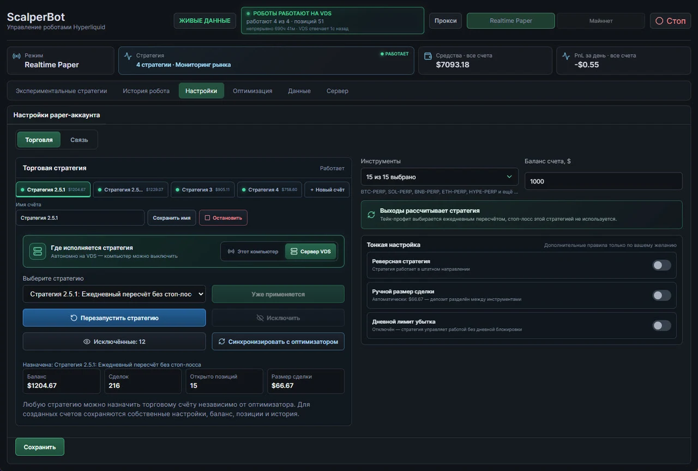

# ScalperBot - терминал анализа рынка

Автор проекта - **Евгений Толмачев**. [Профиль GitHub](https://github.com/EvgenyET) · [Проект в портфолио](https://evgeny-dev.pro/project.html?id=ScalperBot)

Терминал Hyperliquid для анализа стакана и ленты сделок. Отслеживание крупных заявок, виртуальные позиции, архив событий и историческая проверка стратегий.

## Задача проекта

Проект объединяет обработку потока рыночных данных и воспроизводимое исследование стратегий. Приём событий, обнаружение крупных уровней, правила входа, виртуальное исполнение и хранение разделены на модули. Такой подход позволяет разбирать результаты на уровне событий и сделок.

## Мой вклад

Разработал настольную оболочку Electron, React-интерфейс и движок на TypeScript. Реализовал подключение к Hyperliquid, локальное представление стакана, обнаружение крупных уровней и сопоставление с лентой сделок. Добавил виртуальный счёт, управление риском, запись и чтение архива, построение свечей, EMA-фильтр и историческое сравнение параметров.

## Интерфейс

**Таблица рыночных данных терминала**

**Настройка параметров терминала**

## Как работает приложение

ScalperBot помогает исследовать поведение крупных лимитных заявок на рынке Hyperliquid. Терминал сопоставляет изменения стакана с потоком сделок и показывает, как уровень исполняется, снимается или пополняется. Рыночные события можно записать в архив, воспроизвести и использовать для проверки торговых правил. Виртуальный счёт учитывает позиции, комиссии и проскальзывание, а инструменты оптимизации позволяют сравнивать настройки и разбирать отдельные сделки.

## Возможности

- Подключение к публичным HTTP/WebSocket API Hyperliquid, стакан и лента реальных сделок.
- Обнаружение крупных лимитных уровней относительно соседних заявок и классификация их изменений.
- Виртуальные позиции с расчётом комиссий, проскальзывания и условий выхода.
- Запись рыночных событий в архив, повторное воспроизведение и историческая оптимизация.
- Сравнение вариантов с EMA 120 на нескольких интервалах, подробности сделок и статистика результатов.

## Техническое устройство

### Настольная оболочка и интерфейс

Electron отвечает за окно и preload, а React/Vite - за панели терминала, графики и взаимодействие пользователя с движком.

### Движок и рыночные данные

Fastify backend принимает команды и передаёт состояние интерфейсу по WebSocket. Адаптер Hyperliquid и модуль market-data нормализуют поток стакана и сделок.

### Анализ потока и симуляция

Детектор выделяет уровни с необычно большим объёмом, трекер сопоставляет исчезновение ликвидности с потоком сделок, а отдельные модули формируют сигналы и моделируют исполнение с ограничениями риска.

### Архив и исследование стратегий

Архивные данные читаются отдельно от живого потока. Модули тестирования и оптимизации обрабатывают исторические прогоны, EMA строится по закрытым свечам и используется для последующих решений.

## Технологии

| Технология | Роль в проекте |
| --- | --- |
| TypeScript | Общие типы рыночных событий, логика модулей и интерфейс терминала. |
| React | Панели терминала, состояние интерфейса и интерактивные сценарии. |
| Electron | Настольное приложение для Windows и запуск локального движка. |
| Fastify / WebSocket | Команды управления и поток обновлений между движком и интерфейсом. |
| Hyperliquid API | Публичный стакан и лента рыночных сделок. |
| JSONL | Локальные события и сохранение состояния для анализа и воспроизведения. |

## Состояние показанной версии

- Публичный стакан L2 не раскрывает очередь отдельных заявок, классификация исполнения основана на оценке.
- Режим REALTIME_PAPER моделирует сделки на настоящих рыночных данных и не равен реальному биржевому исполнению.
- Для EMA 120 требуется непрерывный период прогрева, пропуски свечей не заполняются вымышленными ценами.

## Демонстрация

На странице портфолио доступны описание, галерея и видеодемонстрация проекта. [Открыть ScalperBot - терминал анализа рынка](https://evgeny-dev.pro/project.html?id=ScalperBot).
